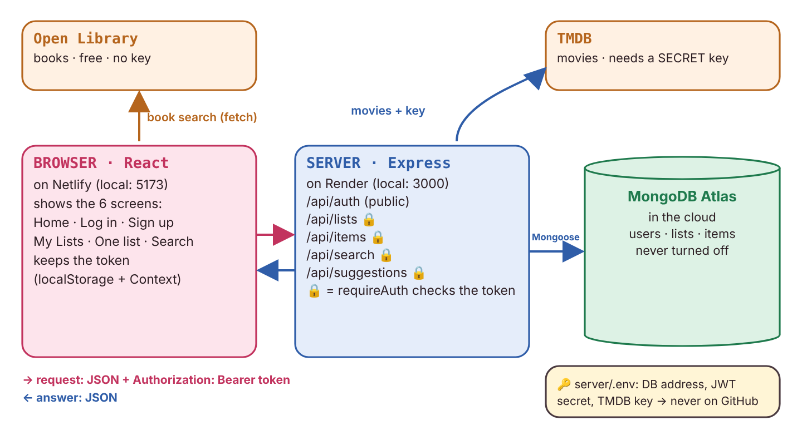
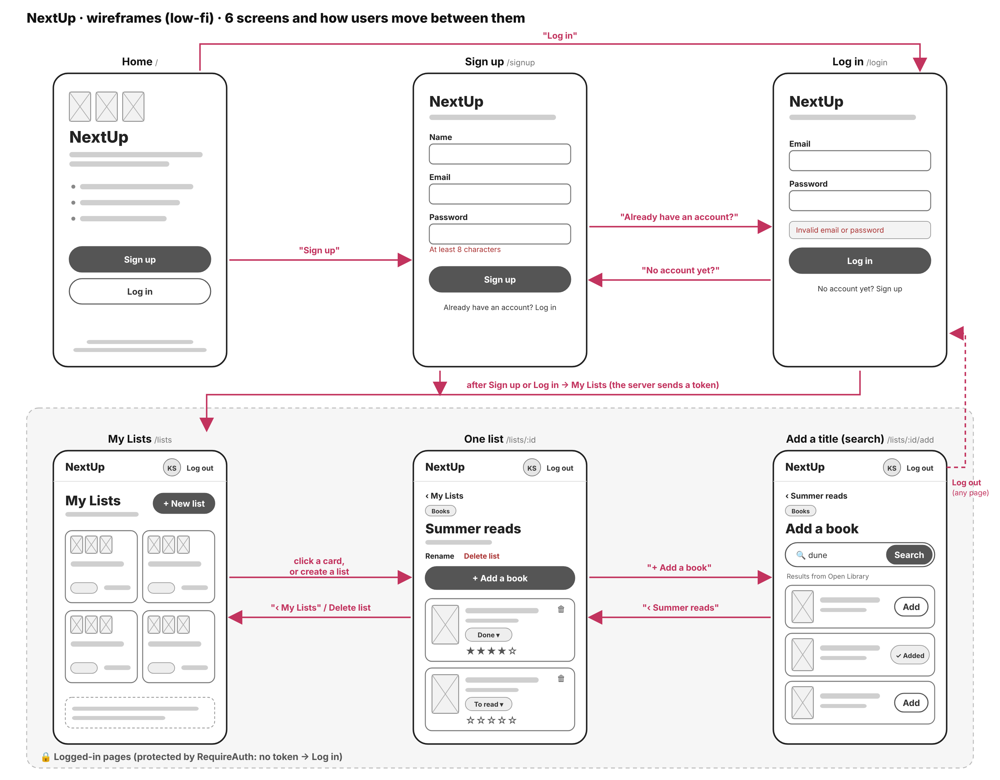
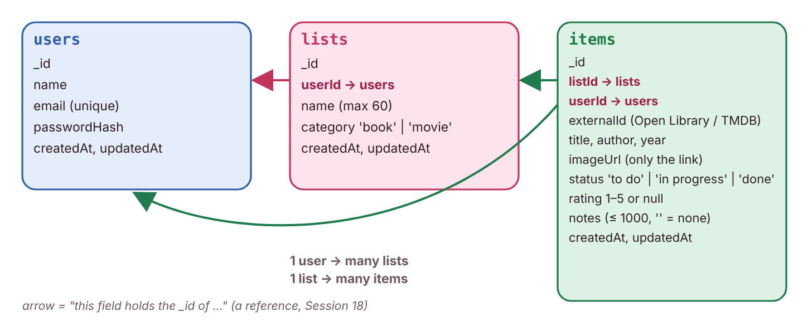
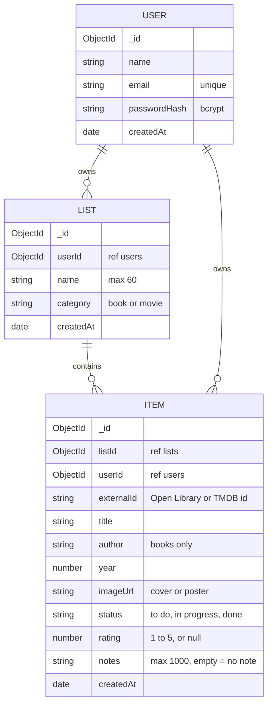
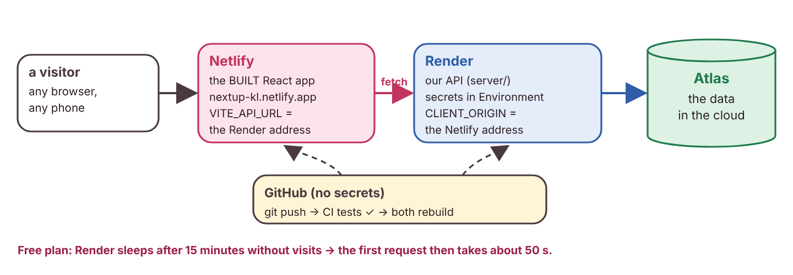
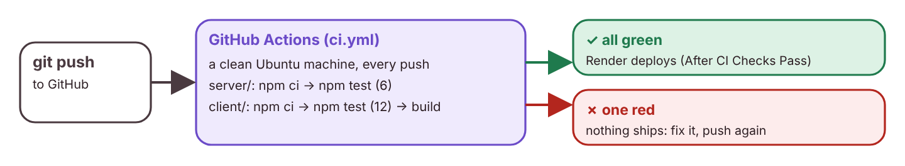
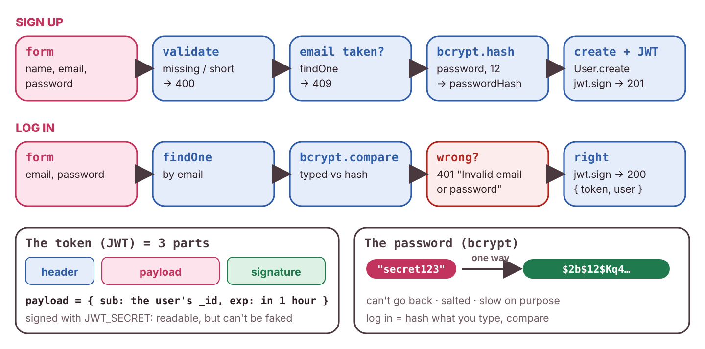
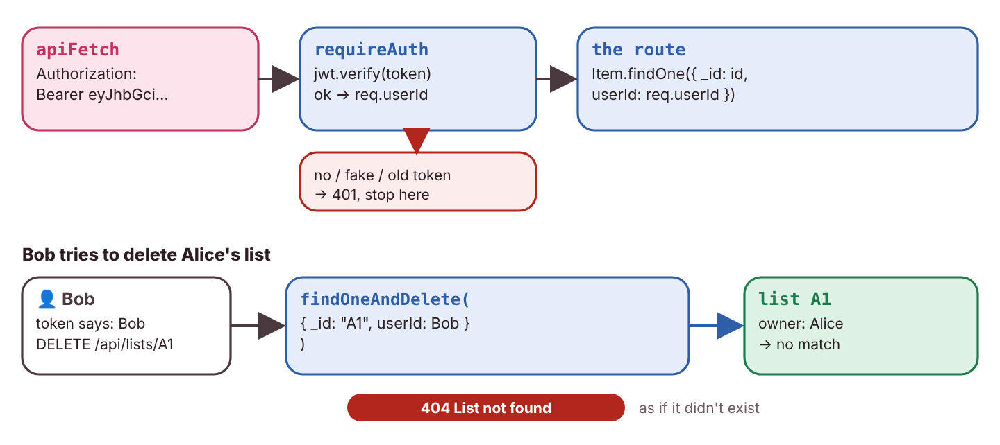

# NextUp

**Everything you want to read or watch next, in your own lists.**

Friends recommend books and movies, we see them on social media or in class, and then we forget them. NextUp is one simple place for both: you make your own lists (like "Summer reads" or "Horror movies"), search real book and movie databases to add titles, and track each title with a status and a rating out of 5.

Capstone project for the Web Development course (USJ, semester 7), by **Kristy Sawan** and **Lynn Hachem**.

| | |
| --- | --- |
| Live app | https://nextup-kl.netlify.app |
| Live API | https://nextup-api-23mj.onrender.com/api/health |

The API runs on Render's free plan: after 15 minutes without visitors it goes to sleep, so the first request can take up to a minute.

## Features

- **Accounts**: sign up, log in and log out. Passwords are hashed with bcrypt.
- **Lists**: create, rename and delete your own lists. Each list has a category: **Books** or **Movies**.
- **Search**: a Books list searches [Open Library](https://openlibrary.org) by title or author, and a Movies list searches [TMDB](https://www.themoviedb.org) by title.
- **Add titles** from the search results in one click. Titles already in the list show "✓ Added".
- **Filter the search results**: by year (before 1980, 1980–1999, 2000–2014, 2015 and after), only titles with a cover, or hide the titles already in the list. "Showing 8 of 20" says when a filter hides something, and the filters stay when you search again.
- **Suggestions**: under your lists, My Lists suggests this week's trending books (Open Library) and popular movies (TMDB), in two tabs: Books · Movies. Choose one of your lists in "Add to:", then add a title with "+ Add". Its list card updates right away.
- **Track each title**: change its status (to read / reading / done, or to watch / watching / done), rate it from 1 to 5 stars, or remove it.
- **Notes on each title**: write a short note on any title (for example what you thought of a book you finished), up to 1000 characters. It's saved with the title, so it's still there after a refresh, a log out, or on another computer.
- **Filter by status**: pills above the titles (All · To read · Reading · Done, or All · To watch · Watching · Done) show how many titles each status has. Click one to see only those titles.
- **Fast pages**: when you go back to a page you already opened, its data shows at once from a small cache, and the app refreshes it in the background. The first time a page loads, grey skeleton blocks show where the content will appear.
- **Private**: the My Lists page and the list pages are only for logged-in users, and each user only ever sees their own lists.
- **Responsive**: built mobile-first, so it works on a phone and on a desktop.

## Tech stack

| Part | Choice |
| --- | --- |
| Front end | React 19 with Vite, React Router for client-side routing |
| Back end | Node.js and Express 5, a RESTful JSON API |
| Database | MongoDB (MongoDB Atlas) with Mongoose |
| Authentication | bcrypt for hashing passwords, JSON Web Tokens (JWT) sent as `Authorization: Bearer <token>` |
| Third-party APIs | Open Library (books, no key needed), TMDB (movies, the key stays on the server) |
| Security | helmet (secure headers), express-rate-limit (rate limits), zod (input validation) |
| Tests | Vitest for the unit tests (with React Testing Library and user-event) and the integration tests (with supertest), Playwright for the end-to-end tests (with an in-memory MongoDB) |

## Architecture

The 3 parts and how they talk (React in the browser, the Express API, MongoDB Atlas), plus Open Library and TMDB:



```
 Browser: React app (client/)                 Express API (server/)                    MongoDB Atlas
 ┌──────────────────────────┐   fetch + JWT   ┌───────────────────────────┐  Mongoose  ┌──────────────┐
 │ pages ─ components       │ ──────────────▶ │ helmet ─ cors ─ limits    │ ─────────▶ │ users        │
 │ AuthContext (token)      │                 │ requireAuth ─ zod         │            │ lists        │
 │ apiFetch ─ useApi        │ ◀────────────── │ routes: auth, lists,      │ ◀───────── │ items        │
 └──────────┬───────────────┘      JSON       │ items, search             │            └──────────────┘
            │                                 └────────────┬──────────────┘
            │ book search (no key)                         │ movie search (with the secret key)
            ▼                                              ▼
       Open Library                                      TMDB
```

- The **client** and the **server** are two separate programs in one repository, each with its own `package.json` and `.env`.
- Every request to our API goes through one function, `apiFetch` (`client/src/api/client.js`). It adds the API's base URL and the login token, and turns error answers into JavaScript errors.
- Pages load their data with the `useApi` hook (`client/src/hooks/useApi.js`). It keeps a small cache in memory (path → data): a page you already visited shows its data at once, then refreshes it in the background. Logging out clears the cache, so the next user never sees the previous user's lists.
- On the server, `requireAuth` checks the token on every `/api/lists`, `/api/items`, `/api/search` and `/api/suggestions` request and sets `req.userId`. Every database query then filters by `userId`, so a user can never read or change someone else's data (it answers 404, as if the data didn't exist).
- The movie search goes **through our API**, so the TMDB key stays in `server/.env` and never reaches the browser. Open Library needs no key, so the browser asks it directly.

### Pages

| URL | Page | Who can see it |
| --- | --- | --- |
| `/` | Home | everyone |
| `/login` | Log in | everyone |
| `/signup` | Sign up | everyone |
| `/lists` | My Lists | logged-in users |
| `/lists/:id` | One list, with its titles | logged-in users (owner only) |
| `/lists/:id/add` | Search and add titles | logged-in users (owner only) |

### Wireframes

The 6 screens and how users move between them (low-fi):



### Database schema

The 3 collections and their references (`userId`, `listId`):



A user has many lists, and a list has many items. The list's category decides which API the search uses.



Each item also stores its `userId`, so every item query can check the owner directly.

### API routes

All routes except `/api/auth/*` and `/api/health` need the header `Authorization: Bearer <token>`. Errors always come back as JSON: `{ "error": "..." }`.

| Method | Path | What it does | Success | Can fail |
| --- | --- | --- | --- | --- |
| POST | `/api/auth/signup` | create an account, returns `{ token, user }` | 201 | 400, 409 |
| POST | `/api/auth/login` | log in, returns `{ token, user }` | 200 | 400, 401 |
| GET | `/api/lists` | my lists, with the number of titles in each and the covers of its 3 newest titles | 200 | 401 |
| POST | `/api/lists` | create a list `{ name, category }` | 201 | 400, 401 |
| GET | `/api/lists/:id` | one of my lists | 200 | 400, 401, 404 |
| PATCH | `/api/lists/:id` | rename a list `{ name }` | 200 | 400, 401, 404 |
| DELETE | `/api/lists/:id` | delete a list and its titles | 204 | 400, 401, 404 |
| GET | `/api/lists/:id/items` | the titles in a list | 200 | 400, 401, 404 |
| POST | `/api/lists/:id/items` | add a title `{ externalId, title, author, year, imageUrl }` | 201 | 400, 401, 404, 409 |
| PATCH | `/api/items/:id` | change `{ status }`, `{ rating }` and/or `{ notes }` | 200 | 400, 401, 404 |
| DELETE | `/api/items/:id` | remove a title | 204 | 400, 401, 404 |
| GET | `/api/search/movies?q=` | search TMDB (through our server) | 200 | 400, 401, 500 |
| GET | `/api/suggestions/books` | this week's trending books (Open Library), kept 1 hour on the server | 200 | 401, 500 |
| GET | `/api/suggestions/movies` | popular movies (TMDB, through our server), kept 1 hour on the server | 200 | 401, 500 |
| GET | `/api/health` | check that the server is running | 200 | |

### Project structure

```
nextup/
├── SECURITY.md                security audit: 7 attacks, before and after the fixes
├── PERFORMANCE.md             Lighthouse scores and bundle sizes, before and after
├── docs/                      wireframes and diagrams
├── client/                    React app (Vite), runs on http://localhost:5173
│   ├── .env.example           what goes in .env.development
│   └── src/
│       ├── main.jsx           mounts the app with the router and the auth provider
│       ├── App.jsx            the routes (which URL shows which page), logged-in pages loaded lazily
│       ├── index.css          all the styles (design tokens, mobile-first)
│       ├── format.js          small text helpers
│       ├── labels.js          the status words of each category (To read, To watch, …)
│       ├── setupTests.js      adds toBeInTheDocument() and friends to the tests
│       ├── api/               client.js (apiFetch), search.js (Open Library + movies)
│       ├── hooks/useApi.js    loads data from the API, with a small cache (data, error, loading, reload)
│       ├── auth/              AuthContext (token, login, signup, logout), RequireAuth
│       ├── pages/             Home, Login, Signup, MyLists, List, Search
│       └── components/        Header, ListCard, ItemCard, StatusFilter, Skeleton, StarRating, …
├── e2e/                       end-to-end tests (Playwright), with their own package.json
│   ├── start-api.js           starts our API on port 3001 with an in-memory MongoDB
│   ├── playwright.config.js   Chromium only, starts the API and the built client
│   └── nextup.spec.js         the 2 end-to-end tests
└── server/                    Express API, runs on http://localhost:3000
    ├── .env.example           what goes in .env
    ├── app.js                 middleware (helmet, cors, body size, rate limits) and routes
    ├── server.js              checks the env variables, connects to MongoDB, then starts the server
    ├── vitest.config.js       a fake JWT secret, only for the tests
    ├── models/                User, List, Item (Mongoose schemas + indexes)
    ├── routes/                auth, lists, items, search, suggestions
    ├── middleware/            requireAuth (checks the token), validate (zod schemas)
    ├── auth/token.js          signs and verifies the JWT
    └── tests/api.test.js      integration tests (Vitest + supertest)
```

## Deployment

Netlify hosts the React app, Render runs the API (its secrets are in Render's Environment settings), and Atlas keeps the data:



GitHub Actions runs the tests at every push (`.github/workflows/ci.yml`), and Render deploys only after they pass ("After CI Checks Pass"):



## Run it on your computer

You need [Node.js](https://nodejs.org) (version 22 or newer), a free [MongoDB Atlas](https://www.mongodb.com/atlas) database, and a free [TMDB API key](https://www.themoviedb.org/settings/api).

### 1. The API (first terminal)

```
cd server
npm install
cp .env.example .env
```

(In Windows PowerShell, use `Copy-Item .env.example .env` instead of `cp`.)

Then open `server/.env` and fill in:

| Variable | What to put |
| --- | --- |
| `PORT` | `3000` |
| `CLIENT_ORIGIN` | `http://localhost:5173` (the address of the React app, with no `/` at the end) |
| `MONGODB_URI` | your Atlas connection string. In Atlas: create a free cluster, add a database user, allow your IP under Network Access, then copy the connection string. |
| `JWT_SECRET` | a long random string. Make one with `node -p "crypto.randomBytes(32).toString('hex')"` |
| `TMDB_API_KEY` | your TMDB API key (the short "API Key", not the long "Read Access Token") |

Start it:

```
npm run dev
```

The terminal shows `connected to MongoDB` and `API listening on port 3000`. If a variable is missing, the server stops right away with `Missing env var: …` and the name of the missing one.

### 2. The React app (second terminal)

```
cd client
npm install
cp .env.example .env.development
npm run dev
```

Open http://localhost:5173 and create an account.

### 3. Tests

The tests follow the 3 kinds of tests of Session 22, "Many small tests, few big ones":

| Kind | Tests | What it tests | Files | Tools | Run it |
| --- | --- | --- | --- | --- | --- |
| **Unit** (milliseconds) | 12 | one function or one component, alone | `client/src/format.test.js`, `client/src/components/StarRating.test.jsx`, `client/src/components/ItemNotes.test.jsx` | [Vitest](https://vitest.dev), React Testing Library, user-event | `cd client` then `npm test` |
| **Integration** (tens of ms) | 6 | a route with its middleware, through supertest | `server/tests/api.test.js` | Vitest, supertest | `cd server` then `npm test` |
| **End-to-end** (seconds) | 2 | a real browser on the whole app: the built client, our API and a database | `e2e/nextup.spec.js` | [Playwright](https://playwright.dev), mongodb-memory-server | `cd e2e` then `npm test` |

GitHub Actions runs the unit and integration tests on every push (`.github/workflows/ci.yml`).

In `client` and `server`, `npm run test:watch` runs the tests again every time you save a file.

**Unit (12 tests).** `plural` gives "0 titles", "1 title" and "4 titles". `initials` handles 2 names, extra spaces, one word, three words (only 2 letters) and an empty name. The `StarRating` component shows 5 stars with the right label, and clicking a star sends that number to the parent. The `ItemNotes` component saves a new note without its extra spaces, and Cancel saves nothing and keeps the old note.

**Integration (6 tests).** They send requests straight to the Express app, with no port and no database:
- `GET /api/health` answers 200
- `GET /api/lists` and `GET /api/suggestions/movies` without a token answer 401
- signing up with a short password answers 400
- a note longer than 1000 characters answers 400 (`notes must be 1000 characters or less`)
- creating a list with an empty name answers 400, even with a valid token

They don't need a `.env` file: `vitest.config.js` gives them a fake `JWT_SECRET`.

**End-to-end (2 tests).** A real Chromium browser clicks through the app like a user:
- opening `/lists` without being logged in sends you to Log in
- the main journey: sign up, create a Books list, rename it, go back to My Lists, reload the page, log out, log in again, and the list is still there

The first time, install the e2e tools (`server` and `client` need their own `npm install` too):

```
cd e2e
npm install
npx playwright install chromium
npm test
```

`npm test` starts everything by itself and stops it at the end:
- **the API on port 3001** (`start-api.js`), with an in-memory MongoDB. It never touches the real database and needs no `.env`.
- **the built client on port 4173** (`npm run build` then `npm run preview`).

The search and the suggestions aren't tested here, because they depend on Open Library and TMDB. The first `npm install` downloads MongoDB once (about 800 MB on Windows).

## Security

How sign up and log in work (bcrypt + JWT):



Every private request goes through `requireAuth`, and every query filters by `userId`: another user gets a 404.



- Passwords are hashed with bcrypt (cost 12). The hash never leaves the server.
- Login answers the same message ("Invalid email or password") whether the email or the password is wrong.
- Every input is validated on the server with **zod**: one schema per request body checks the types, the required fields, the allowed values and a maximum length for every field. Keys that aren't in the schema are dropped. The forms also check before sending, but the server never trusts the browser.
- `mongoose.set('sanitizeFilter', true)` is a backstop against NoSQL injection: a value like `{ "$ne": "" }` is treated as plain data, not as an operator.
- The owner of a list or a title always comes from the token, never from the request body.
- **helmet** adds secure HTTP headers (Content-Security-Policy, Strict-Transport-Security, X-Content-Type-Options, …) and removes `X-Powered-By`.
- **Rate limits** (express-rate-limit): 300 requests per 15 minutes on the whole API, and only 5 login tries per 15 minutes, then `429 Too many attempts`. Request bodies are capped at 10 KB.
- Secrets (`MONGODB_URI`, `JWT_SECRET`, `TMDB_API_KEY`) live only in `server/.env`, which is in `.gitignore`. Only `.env.example` files with placeholder values are committed. The server refuses to start if a secret is missing.

We attacked our own API and fixed what we found: see **[SECURITY.md](SECURITY.md)** (each attack, the answer before, the fix, the answer after).

## Performance

- The logged-in pages are loaded only when you open them (`lazy()` + `<Suspense>`), so the first download is smaller.
- Covers and posters have a fixed `width` and `height`, so nothing jumps while they load, and `loading="lazy"`.
- The two main database queries use indexes (`userId + createdAt` for lists, `listId + userId + createdAt` for titles).
- Pages you already visited show at once from a small cache.

Lighthouse scores, bundle sizes and what changed: see **[PERFORMANCE.md](PERFORMANCE.md)**.

## Credits

Book data and covers come from [Open Library](https://openlibrary.org). Movie data and posters come from [TMDB](https://www.themoviedb.org).

This product uses the TMDB API but is not endorsed or certified by TMDB.
