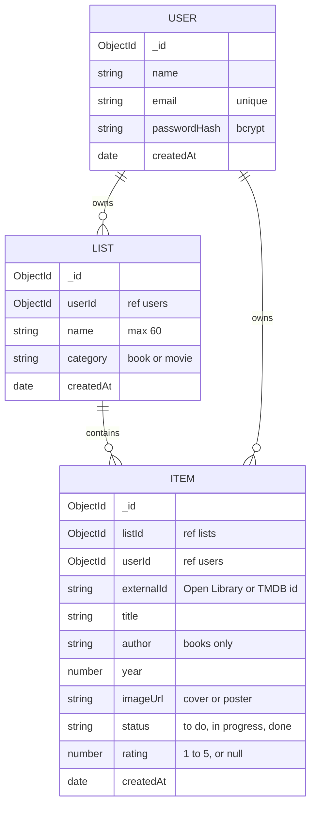

# NextUp

**Everything you want to read or watch next, in your own lists.**

Friends recommend books and movies, we see them on social media or in class, and then we forget them. NextUp is one simple place for both: you make your own lists (like "Summer reads" or "Horror movies"), search real book and movie databases to add titles, and track each title with a status and a rating out of 5.

Capstone project for the Web Development course (USJ, semester 7), by **Kristy Sawan** and **Lynn Hachem**.

| | |
| --- | --- |
| Live app | https://nextup-kl.netlify.app |
| Live API | https://nextup-api-23mj.onrender.com/api/health |

The API runs on Render's free plan: after 15 minutes without visitors it goes to sleep, so the first request can take up to a minute.

## Features

- **Accounts**: sign up, log in and log out. Passwords are hashed with bcrypt.
- **Lists**: create, rename and delete your own lists. Each list has a category: **Books** or **Movies**.
- **Search**: a Books list searches [Open Library](https://openlibrary.org) by title or author, and a Movies list searches [TMDB](https://www.themoviedb.org) by title.
- **Add titles** from the search results in one click. Titles already in the list show "✓ Added".
- **Track each title**: change its status (to read / reading / done, or to watch / watching / done), rate it from 1 to 5 stars, or remove it.
- **Private**: the My Lists page and the list pages are only for logged-in users, and each user only ever sees their own lists.
- **Responsive**: built mobile-first, so it works on a phone and on a desktop.

## Tech stack

| Part | Choice |
| --- | --- |
| Front end | React 19 with Vite, React Router for client-side routing |
| Back end | Node.js and Express 5, a RESTful JSON API |
| Database | MongoDB (MongoDB Atlas) with Mongoose |
| Authentication | bcrypt for hashing passwords, JSON Web Tokens (JWT) sent as `Authorization: Bearer <token>` |
| Third-party APIs | Open Library (books, no key needed), TMDB (movies, the key stays on the server) |
| Tests | Vitest and React Testing Library (front end), Node's built-in test runner (back end) |

## Architecture

```
 Browser: React app (client/)                 Express API (server/)                    MongoDB Atlas
 ┌──────────────────────────┐   fetch + JWT   ┌───────────────────────────┐  Mongoose  ┌──────────────┐
 │ pages ─ components       │ ──────────────▶ │ cors ─ express.json       │ ─────────▶ │ users        │
 │ AuthContext (token)      │                 │ requireAuth (checks JWT)  │            │ lists        │
 │ apiFetch ─ useApi        │ ◀────────────── │ routes: auth, lists,      │ ◀───────── │ items        │
 └──────────┬───────────────┘      JSON       │ items, search             │            └──────────────┘
            │                                 └────────────┬──────────────┘
            │ book search (no key)                         │ movie search (with the secret key)
            ▼                                              ▼
       Open Library                                      TMDB
```

- The **client** and the **server** are two separate programs in one repository, each with its own `package.json` and `.env`.
- Every request to our API goes through one function, `apiFetch` (`client/src/api/client.js`). It adds the API's base URL and the login token, and turns error answers into JavaScript errors.
- On the server, `requireAuth` checks the token on every `/api/lists`, `/api/items` and `/api/search` request and sets `req.userId`. Every database query then filters by `userId`, so a user can never read or change someone else's data (it answers 404, as if the data didn't exist).
- The movie search goes **through our API**, so the TMDB key stays in `server/.env` and never reaches the browser. Open Library needs no key, so the browser asks it directly.

### Pages

| URL | Page | Who can see it |
| --- | --- | --- |
| `/` | Home | everyone |
| `/login` | Log in | everyone |
| `/signup` | Sign up | everyone |
| `/lists` | My Lists | logged-in users |
| `/lists/:id` | One list, with its titles | logged-in users (owner only) |
| `/lists/:id/add` | Search and add titles | logged-in users (owner only) |

### Wireframes

The 6 screens and how users move between them (low-fi):


### Database schema

A user has many lists, and a list has many items. The list's category decides which API the search uses.



Each item also stores its `userId`, so every item query can check the owner directly.

### API routes

All routes except `/api/auth/*` and `/api/health` need the header `Authorization: Bearer <token>`. Errors always come back as JSON: `{ "error": "..." }`.

| Method | Path | What it does | Success | Can fail |
| --- | --- | --- | --- | --- |
| POST | `/api/auth/signup` | create an account, returns `{ token, user }` | 201 | 400, 409 |
| POST | `/api/auth/login` | log in, returns `{ token, user }` | 200 | 400, 401 |
| GET | `/api/lists` | my lists, with the number of titles in each | 200 | 401 |
| POST | `/api/lists` | create a list `{ name, category }` | 201 | 400, 401 |
| GET | `/api/lists/:id` | one of my lists | 200 | 400, 401, 404 |
| PATCH | `/api/lists/:id` | rename a list `{ name }` | 200 | 400, 401, 404 |
| DELETE | `/api/lists/:id` | delete a list and its titles | 204 | 400, 401, 404 |
| GET | `/api/lists/:id/items` | the titles in a list | 200 | 400, 401, 404 |
| POST | `/api/lists/:id/items` | add a title `{ externalId, title, author, year, imageUrl }` | 201 | 400, 401, 404, 409 |
| PATCH | `/api/items/:id` | change `{ status }` and/or `{ rating }` | 200 | 400, 401, 404 |
| DELETE | `/api/items/:id` | remove a title | 204 | 400, 401, 404 |
| GET | `/api/search/movies?q=` | search TMDB (through our server) | 200 | 400, 401, 500 |
| GET | `/api/health` | check that the server is running | 200 | |

### Project structure

```
nextup/
├── client/                    React app (Vite), runs on http://localhost:5173
│   ├── .env.example           what goes in .env.development
│   └── src/
│       ├── main.jsx           mounts the app with the router and the auth provider
│       ├── App.jsx            the routes (which URL shows which page)
│       ├── index.css          all the styles (design tokens, mobile-first)
│       ├── format.js          small text helpers
│       ├── api/               client.js (apiFetch), search.js (Open Library + movies)
│       ├── hooks/useApi.js    loads data from the API (data, error, loading, reload)
│       ├── auth/              AuthContext (token, login, signup, logout), RequireAuth
│       ├── pages/             Home, Login, Signup, MyLists, List, Search
│       └── components/        Header, ListCard, ItemCard, StarRating, SearchBar, …
└── server/                    Express API, runs on http://localhost:3000
    ├── .env.example           what goes in .env
    ├── app.js                 middleware and routes
    ├── server.js              connects to MongoDB, then starts the server
    ├── models/                User, List, Item (Mongoose schemas)
    ├── routes/                auth, lists, items, search
    ├── middleware/            requireAuth (checks the token), validate (checks the input)
    ├── auth/token.js          signs and verifies the JWT
    └── tests/api.test.js      back-end tests
```

## Run it on your computer

You need [Node.js](https://nodejs.org) (version 22 or newer), a free [MongoDB Atlas](https://www.mongodb.com/atlas) database, and a free [TMDB API key](https://www.themoviedb.org/settings/api).

### 1. The API (first terminal)

```
cd server
npm install
cp .env.example .env
```

(In Windows PowerShell, use `Copy-Item .env.example .env` instead of `cp`.)

Then open `server/.env` and fill in:

| Variable | What to put |
| --- | --- |
| `PORT` | `3000` |
| `CLIENT_ORIGIN` | `http://localhost:5173` (the address of the React app, with no `/` at the end) |
| `MONGODB_URI` | your Atlas connection string. In Atlas: create a free cluster, add a database user, allow your IP under Network Access, then copy the connection string. |
| `JWT_SECRET` | a long random string. Make one with `node -p "crypto.randomBytes(32).toString('hex')"` |
| `TMDB_API_KEY` | your TMDB API key (the short "API Key", not the long "Read Access Token") |

Start it:

```
npm run dev
```

The terminal shows `connected to MongoDB` and `API listening on http://localhost:3000`.

### 2. The React app (second terminal)

```
cd client
npm install
cp .env.example .env.development
npm run dev
```

Open http://localhost:5173 and create an account.

### 3. Tests

```
cd server
npm test
```

The back-end tests start the Express app on a free port and check that `GET /api/health` answers 200, that `GET /api/lists` without a token answers 401, and that signing up with a short password answers 400. They don't need a database.

```
cd client
npm test
```

The front-end tests render the `StarRating` component, check that it shows 5 stars with the right label, and check that clicking a star sends that number to the parent.

## Security

- Passwords are hashed with bcrypt (cost 12). The hash never leaves the server.
- Login answers the same message ("Invalid email or password") whether the email or the password is wrong.
- Every input is validated on the server (types, required fields, allowed values, lengths). The forms also check before sending, but the server never trusts the browser.
- The owner of a list or a title always comes from the token, never from the request body.
- Secrets (`MONGODB_URI`, `JWT_SECRET`, `TMDB_API_KEY`) live only in `server/.env`, which is in `.gitignore`. Only `.env.example` files with placeholder values are committed.

## Credits

Book data and covers come from [Open Library](https://openlibrary.org). Movie data and posters come from [TMDB](https://www.themoviedb.org).

This product uses the TMDB API but is not endorsed or certified by TMDB.
